<picture>
  <source media="(prefers-color-scheme: light)" srcset="docs/screenshots/overview-light.png">
  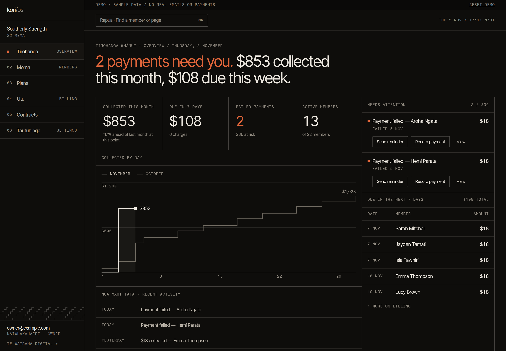
</picture>

# kori/os

Gym management for New Zealand gyms: members, plans, direct debit, contracts and overdue reminders, all on one ledger.

Live demo at https://kori-demo.vercel.app. There's no sign-up. It runs on sample data for a made-up gym, and every button works.

Designed and built by me, Ali Werahiko Te Wairama Harrison ([Te Wairama Digital](https://tewairama.digital)), with Next.js 16, React 19, TypeScript, Supabase, GoCardless and Tailwind CSS 4.

## Why I built it

I built this around the three things a small gym owner asks: who hasn't paid, what's coming in this week, and can I trust these numbers. The app opens on a sentence that answers them, every figure links to the payments behind it, and a failed payment can be chased or settled from its own row.

It's built around a real gym but isn't in use yet, so the demo is the way to see it. The billing code is tested against fakes and hasn't run on a live GoCardless account. That's the next step before it handles real money.

## A look around

Failed payments show up on the Overview. You can send a reminder or record a cash payment from the row, with the amount already filled in, and the alert clears when the money lands.

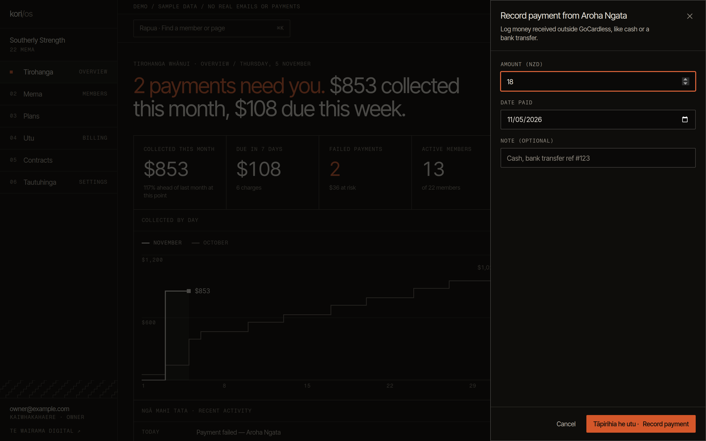

Billing shows direct debit status, upcoming charges and everything collected this month, with a total that matches the headline and a CSV that adds up to it.

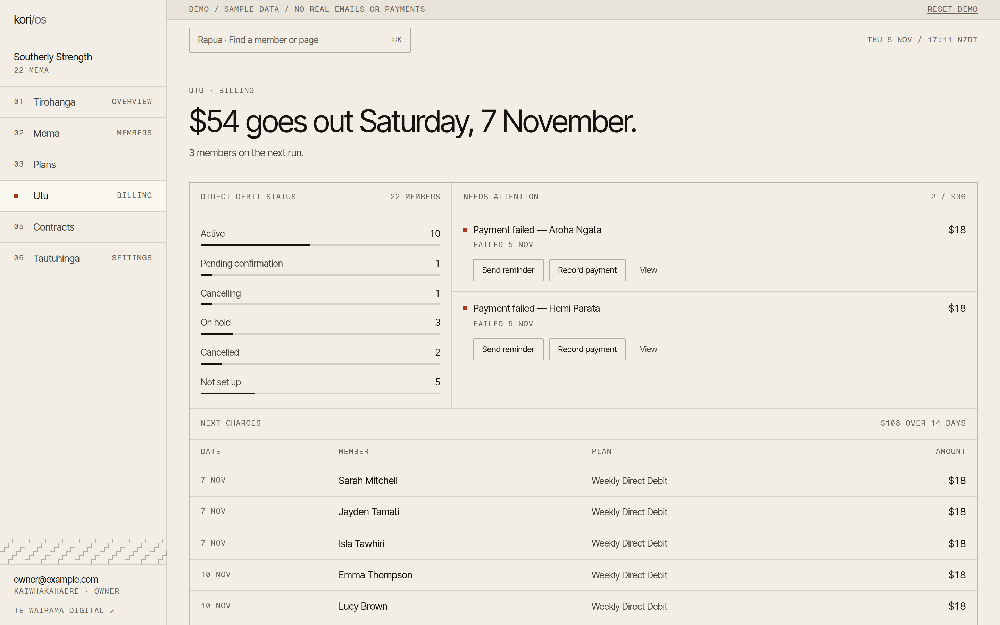

`⌘K` finds anyone from any screen, and the member list filters by status with live counts.

<table>
  <tr>
    <td>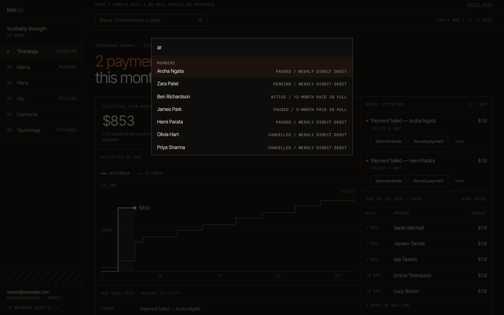</td>
    <td>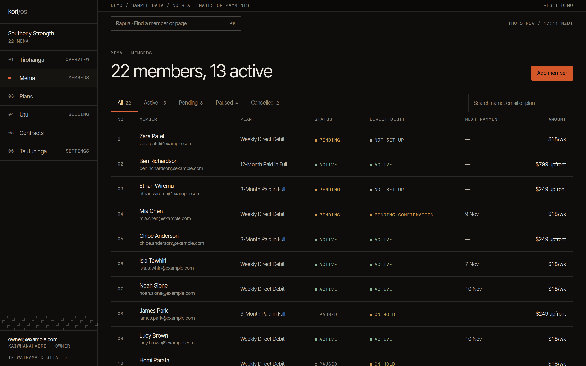</td>
  </tr>
</table>

Each member has their payment history, direct debit status, plan and contract on one page. Plans can bill weekly, monthly or annually, or be paid in full up front.

<table>
  <tr>
    <td>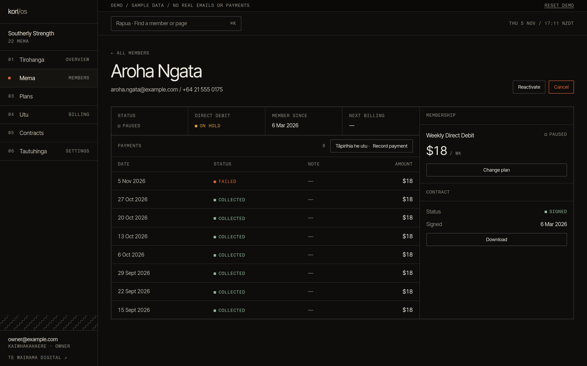</td>
    <td>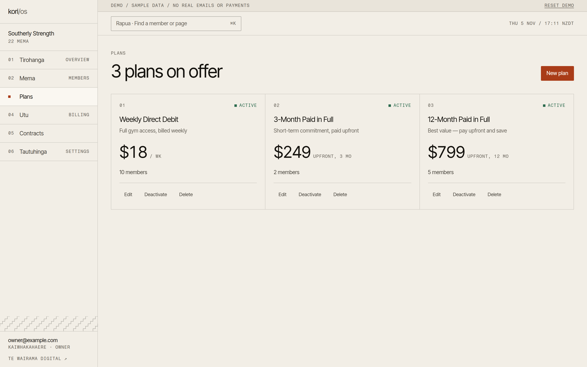</td>
  </tr>
</table>

Contracts and reminder emails are templates the gym edits with a live preview beside them, and contracts generate as PDFs.

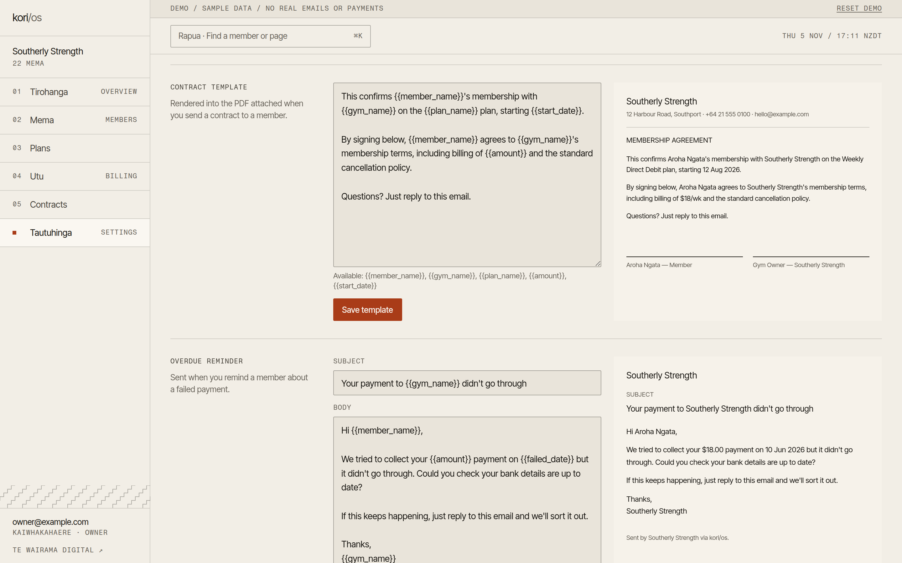

It all works on a phone at the front desk, with dark and light themes and te reo Māori labels that can be turned off.

<p align="center">
  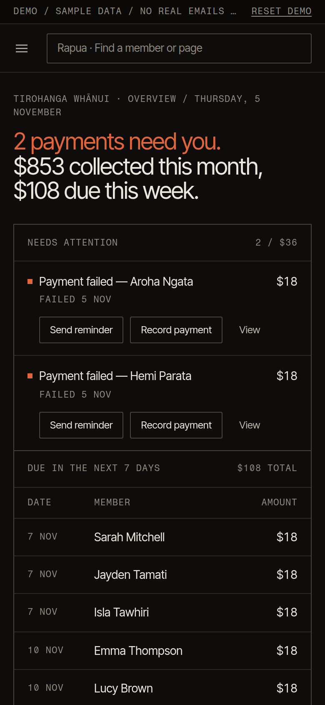
  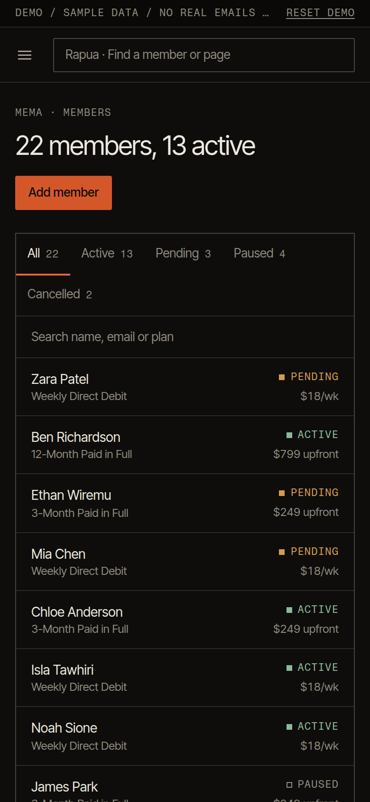
  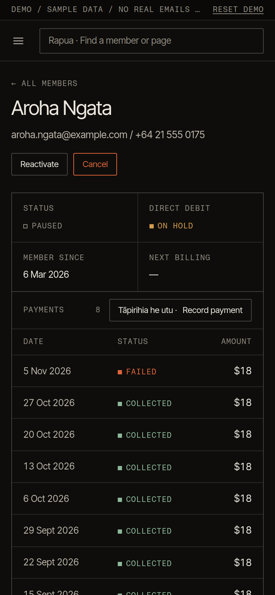
</p>

## How the billing works

Direct debit was the hardest part, because the real answer lives with GoCardless and arrives days later. A payment only counts once a signed webhook confirms it.

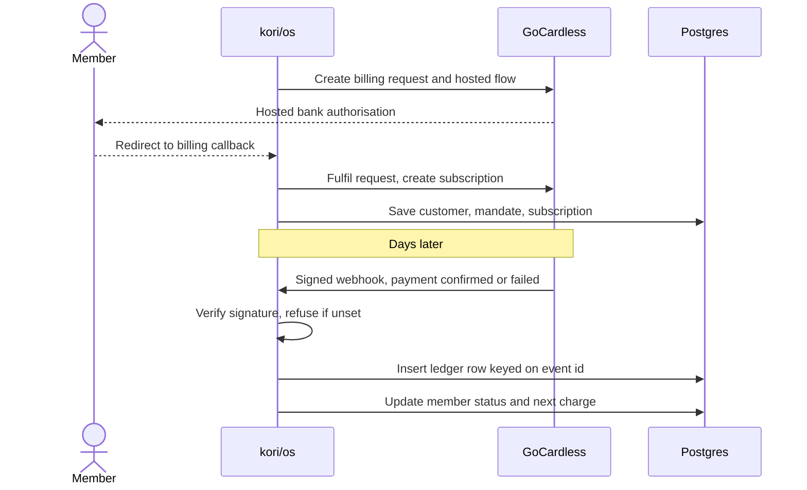

Webhooks fail closed: with no secret or a bad signature, nothing gets processed. A batch is handled event by event, so one bad event can't sink the rest.

Redelivery is safe. Each event is written with `ON CONFLICT DO NOTHING` on its GoCardless id, and a repeat skips the status update too, so a stale "failed" can't knock back a member who has since paid.

Cancelling takes two steps. The subscription goes before the mandate, because a live mandate can still be charged, and the member sits in "Cancelling" until GoCardless confirms it.

The code is in `lib/gocardless-webhook.ts` and `lib/member-cancellation.ts`.

## Other notes

Postgres has row-level security on every table, and actions also check a plan belongs to the gym, because a foreign key doesn't respect RLS. The GoCardless access token is stripped before a gym record reaches a Client Component, contract PDFs sit in a private bucket behind 60-second signed URLs, and the CSV export neutralises spreadsheet formulas.

The public demo has no database. Each visitor's changes are saved in an `HttpOnly` cookie as a list of writes and replayed over the sample data on every request, so nobody sees anyone else's changes and it works on serverless hosting. Demo mode turns off sign-in, so the build refuses to run if any real key is set beside it. See `lib/demo-mode.ts` and `lib/demo-session.ts`.

The Overview, the chart, the Billing ledger and the CSV all use the same functions in `lib/reporting.ts`, and a test checks they agree. Dates are pinned to `Pacific/Auckland`, because hosting runs in UTC and the dashboard would otherwise show yesterday's date every morning.

The look comes from exposed construction: panels on one sheet, lines only where two things meet, numbered rows and mono labels. The palette is pango and muka, with kōkōwai kept for what needs attention and the main action on a screen. The poutama pattern runs along the sidebar and through the empty states, and the chart steps because money lands on charge days. Type is Inter Tight with Fragment Mono, and the chart is hand-built SVG that works from the keyboard and has a table for screen readers.

## Testing

There are 251 unit tests in Vitest, including the write actions run with no session, the way demo mode runs them. axe found no violations on any screen, in both themes, at phone width or with dialogs open. Lighthouse gives 100 for accessibility, best practices and SEO, and for performance 100 on desktop and 96+ on throttled mobile.

## Running it

You don't need any accounts or credentials:

```bash
npm install
cp .env.example .env.local
npm run dev
```

[DEMO.md](DEMO.md) has a five-minute walkthrough, and [docs/setup.md](docs/setup.md) covers connecting real services.
