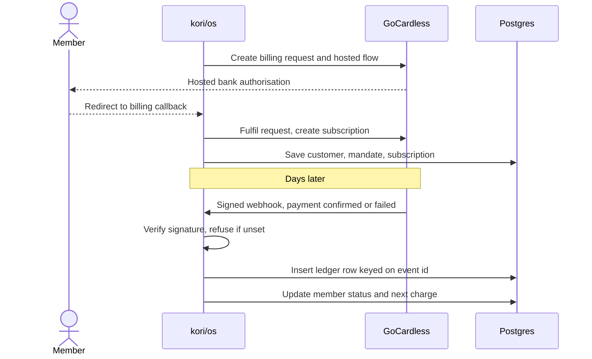

<picture>
  <source media="(prefers-color-scheme: light)" srcset="docs/screenshots/overview-light.png">
  
</picture>

# kori/os

A full-stack gym management app for New Zealand gyms: members, plans, GoCardless direct debit, contracts and overdue reminders, all on one ledger.

Designed and built by me, Ali Werahiko Te Wairama Harrison ([Te Wairama Digital](https://tewairama.digital)).

**[Open the live demo →](https://kori-demo.vercel.app)** No sign-up. It runs on sample data for a made-up gym, and every button works.

Built with Next.js 16, React 19, TypeScript, Supabase, GoCardless and Tailwind CSS 4.

## The idea

A small gym owner doesn't need a wall of charts. They need to know who hasn't paid, what's coming in this week, and whether the numbers can be trusted.

So the app opens on a sentence that says exactly that. Every figure links to the payments behind it, and a failed payment can be chased or settled from its own row without leaving the page.

## What it does

**See the state of the gym.** The Overview leads with what needs you, then the month so far against last month, what's due, and what just happened.

**Fix problems where they appear.** Send a reminder or record a cash payment straight from the failed payment. The amount is already filled in, and the alert clears when the money lands.


**Trust the numbers.** Billing shows direct debit status, upcoming charges and every payment collected this month, with a total that matches the headline and a CSV export that adds up to it.


**Find anyone fast.** `⌘K` from any screen, a few letters of a name, Enter. The Members list filters by status with live counts.

<table>
  <tr>
    <td></td>
    <td></td>
  </tr>
</table>

**Keep everything about a member in one place.** Payment history, direct debit status, plan and contract on one page. Plans can bill weekly, monthly, annually or be paid in full up front.

<table>
  <tr>
    <td></td>
    <td></td>
  </tr>
</table>

**Write it in your own words.** Contracts and reminder emails are templates the gym edits, with a live preview beside them. Contracts generate as PDFs.


**Run it from the front desk.** Everything works on a phone, with dark and light themes, and te reo Māori labels that can be turned off.

<p align="center">
  
  
  
</p>

## How it's built

| Layer | Tools |
| --- | --- |
| **Frontend** | Next.js 16 App Router, React 19 Server Components, TypeScript, Tailwind CSS 4 |
| **Backend** | Server Actions, Route Handlers, route protection in `proxy.ts` |
| **Data** | Supabase Postgres with row-level security on every table, Supabase Storage |
| **Auth** | Supabase magic links |
| **Payments** | GoCardless: OAuth, Billing Request Flow, subscriptions, signed webhooks |
| **Documents** | `@react-pdf/renderer` for contracts, Resend for email |
| **Testing** | Vitest |
| **Hosting** | Vercel |

## Engineering notes

### The billing loop

Direct debit is the hard part, because the truth lives somewhere else and arrives late. A payment isn't real when the app asks for it, only when a signed webhook says so.



- **Webhooks fail closed.** No secret or a bad signature means nothing gets processed. A batch is handled event by event, so one bad event can't sink the rest.
- **Redelivery is safe.** Each event is written with `ON CONFLICT DO NOTHING` on its GoCardless id. If it's already been seen, the status update is skipped too, so a stale "failed" can't knock back a member who has since paid.
- **Cancelling is two-phase.** The subscription is cancelled before the mandate, because a live mandate can still be charged. The member then sits in "Cancelling" until GoCardless confirms, so the screen never claims something that hasn't happened. A half-finished cancellation is logged loudly and never written as a success.

See `lib/gocardless-webhook.ts` and `lib/member-cancellation.ts`.

### Keeping data where it belongs

- Row-level security on every table. Actions also check a plan belongs to the gym, because a foreign key doesn't respect RLS.
- The GoCardless access token is stripped before a gym record can reach a Client Component.
- Contract PDFs live in a private bucket, reached through 60-second signed URLs.
- The CSV export neutralises spreadsheet formulas, because names and notes are free text.

### A public demo with no backend

The live demo has no database. Each visitor's changes are saved in an `HttpOnly` cookie as a list of writes, replayed over the sample data on every request.

The server stores nothing, so one visitor never sees another's changes, and it holds up on serverless hosting where requests land on different machines. The cookie is treated as untrusted input: an edited one can only break that visitor's own session.

Demo mode turns off sign-in, so it's only allowed where nothing real exists. The build refuses to run if any Supabase, GoCardless or Resend key is set beside it, and the demo turns itself off at runtime if one appears later. See `lib/demo-mode.ts` and `lib/demo-session.ts`.

### One source of truth for the numbers

The Overview figure, the chart, the Billing ledger and the CSV all use the same month window, and the aggregation lives in pure functions in `lib/reporting.ts` that demo mode shares. A test asserts the figure, the chart and the ledger agree.

Dates are pinned to `Pacific/Auckland`. Hosting runs in UTC, 12 to 13 hours behind New Zealand, so without this the dashboard shows yesterday's date every morning.

## Design notes

The look comes from exposed construction. Panels sit on one sheet, and the lines between them are the seams, so a line is only drawn where two things actually meet. Rows are numbered and labels are mono, like a ledger.

The palette is pango and muka, for the dark and light themes, with kōkōwai as the accent. Kōkōwai has one job: it marks what needs attention and the main action on a screen. The chart line stays neutral for that reason.

The poutama, the stepped pattern from tukutuku panels, runs along the sidebar and through the empty states. The chart steps too, because money lands on charge days rather than trickling in.

Type is Inter Tight with Fragment Mono for labels. The chart is hand-built SVG with no library, works from the keyboard and has a table for screen readers. Dialogs are native `<dialog>`, and tables are real tables.

Every colour is a token in `app/globals.css`. Tests stop raw colours creeping into components and check every text pairing against WCAG AA in both themes.

## Quality

| Check | Result |
| --- | --- |
| **Unit tests** | 251 passing, including the write actions run with no session, the way demo mode runs them |
| **Accessibility** | 0 axe violations across every screen, both themes, phone width and open dialogs |
| **Lighthouse** | 100 for accessibility, best practices and SEO |
| **Performance** | 100 on desktop, 96+ on throttled mobile, no layout shift |

## Status

Built around a real gym, but not in use yet. The demo is the way to see it for now.

The billing code is covered by tests against fakes, and it hasn't run against a live GoCardless account. That's the next step before it handles real money.

## Running it

No accounts or credentials needed:

```bash
npm install
cp .env.example .env.local
npm run dev
```

[DEMO.md](DEMO.md) has a five-minute walkthrough, and [docs/setup.md](docs/setup.md) covers connecting real services.
